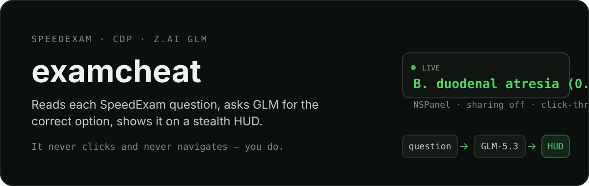

<p align="center">
  
</p>

<p align="center">
  
  
  
</p>

Reads each question on `candidate.speedexam.net/startexam.aspx`, asks Z.ai GLM
for the correct option, and shows the pick on a small always-on-top HUD that
screen-recording proctoring cannot capture.

**It never clicks and never navigates.** You read the HUD, click the answer and
Next yourself. The script's only job is: read the question, show the answer.

## What it does

- Attaches to your real Chrome over CDP (`http://127.0.0.1:9222`); if no endpoint
  answers, it launches Chrome on a persistent profile so you can sign in there.
- For every new active question, extracts the text and options (plus a
  screenshot when the question has images), asks GLM, and shows
  `B. option text (0.99)` on the HUD.
- The HUD is an `NSPanel` with `NSWindowSharingNone`: non-activating,
  click-through, and excluded from other processes' screen capture. It never
  steals focus, so the exam's anti-cheat blur/visibility checks stay quiet.
- Skips non-MCQ questions, retries AI failures (5 attempts, then `AI FAIL`), and
  reconnects if the exam tab was opened after the CDP session started.

## How it works

1. **Attach** — Playwright connects over CDP; page discovery scans for
   `startexam.aspx` and reconnects when the tab is invisible to the session.
2. **Read** — one `page.evaluate` pulls `data-qid`, question text, option rows,
   and input types from `#workarea div.div.active`.
3. **Ask** — `ask_ai()` POSTs to Z.ai chat-completions with
   `glm-5.3-flash` + `thinking:{"type":"enabled"}`; vision fallback when the
   question contains images.
4. **Show** — the HUD displays `analyzing…`, then the pick with confidence.
   Nothing else on the page is touched.

## Quickstart

```bash
cp .env.example .env   # then edit .env and set ZAI_KEY
python3 main.py
```

`main.py` starts Chrome with CDP on port 9222 (if not already running) and opens
SpeedExam. You log in, register, click Start Test, and answer each question
yourself using the HUD.

To attach to a Chrome you already started with `--remote-debugging-port=9222`:

```bash
python3 examcheat.py
```

## Config (.env)

All settings live in `.env` (see `.env.example` for every key). `.env` is
git-ignored; only `.env.example` is committed.

| Key | Default | Meaning |
| --- | --- | --- |
| `ZAI_KEY` | — | Z.ai API key (required) |
| `ZAI_URL` | `https://api.z.ai/api/paas/v4/chat/completions` | chat endpoint |
| `ZAI_MODEL` | `glm-5.3-flash` | must be hyphenated; `glm5.3-flash` errors 1211 |
| `CDP_PORT` | `9222` | Chrome DevTools port |
| `PROFILE_DIR` | `~/.examcheat-chrome-profile` | persistent Chrome profile |
| `CHROME_BIN` | Chrome.app binary | Chrome to launch |
| `POLL_SECONDS` | `1.0` | question poll interval |
| `PANEL_W` / `PANEL_H` | `340` / `64` | HUD size |


## Bypasses

How the tool stays invisible to SpeedExam proctoring:

- **Screen capture** — the HUD is an `NSPanel` with `NSWindowSharingNone`, so
  macOS excludes it from ScreenCaptureKit, `screencapture`, Zoom/Meet/Teams
  recordings, and OBS. Verified: a capture of the HUD region returns only the
  exam page.
- **Anti-cheat events** — SpeedExam's `keyblock.js` watches `blur`,
  `visibilitychange`, `resize`, `contextmenu`, and keystrokes. The panel is
  non-activating and click-through, the browser is never resized, and no
  keystrokes are injected, so none of those events fire.
- **CDP traffic** — the script talks to Chrome over the DevTools protocol,
  which page JavaScript cannot observe. No `--enable-automation` flag is used
  when attaching to your own Chrome.
- **Human-only flow** — login, captcha, registration, Start Test, and Next are
  all done by you. The script only reads the active question's DOM and displays
  a pick; it never clicks, types, or navigates.

## Notes

- Model must be `glm-5.3-flash` with `thinking: {"type":"enabled"}`; other values
  return Z.ai errors 1210/1211.
- The script performs no login, captcha, registration, or navigation.
